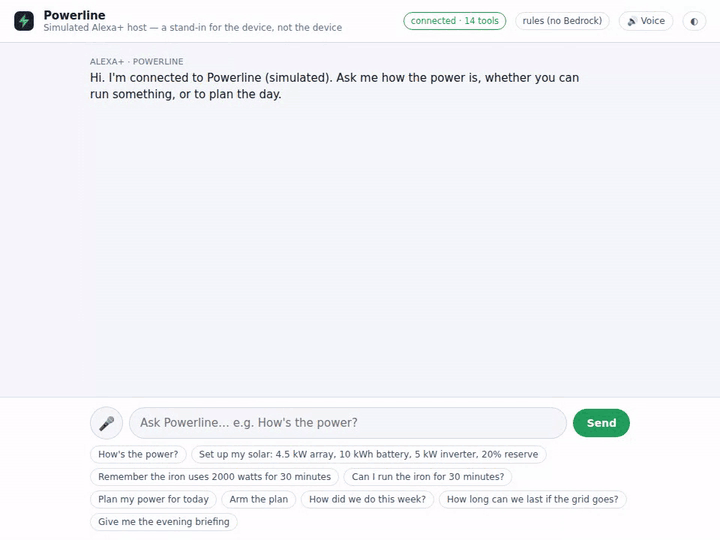
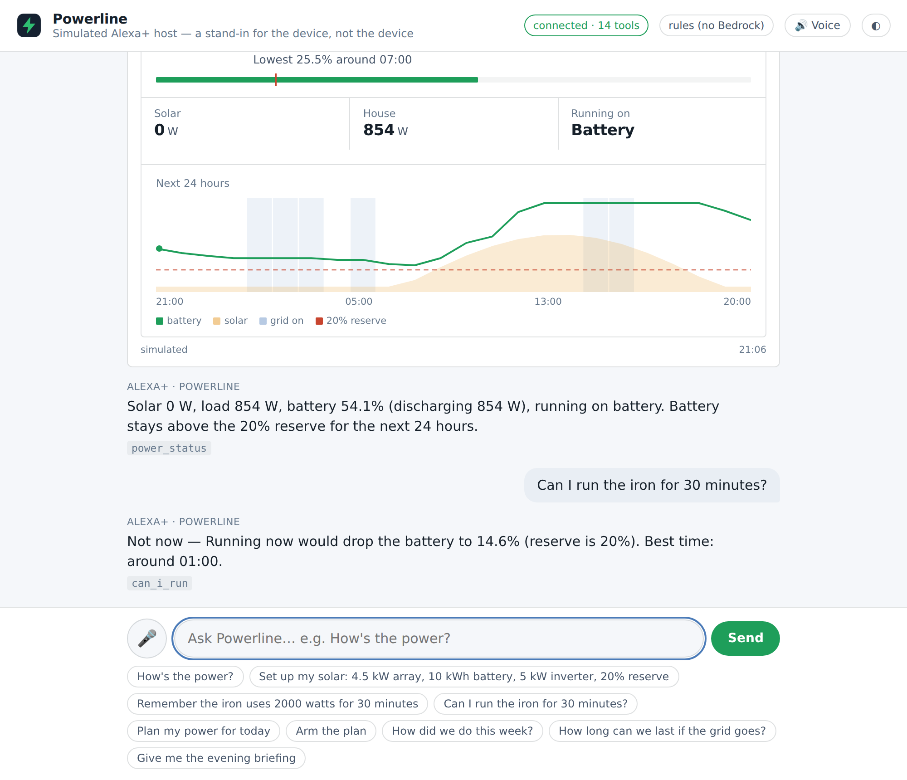
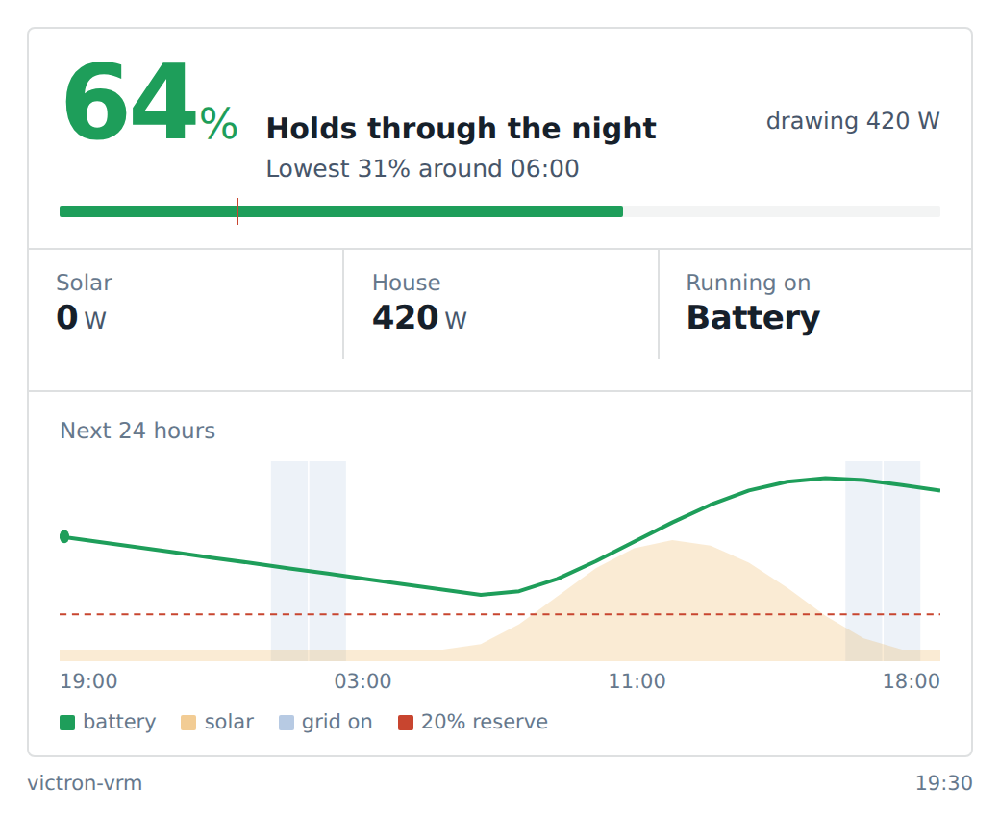
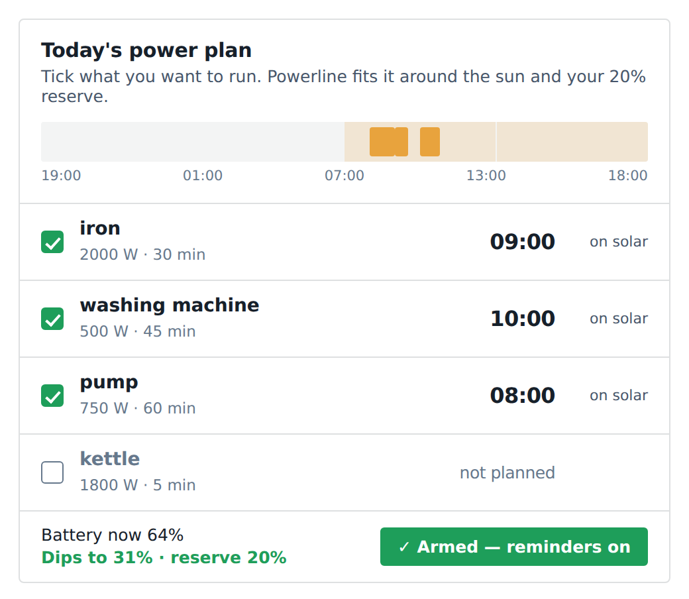
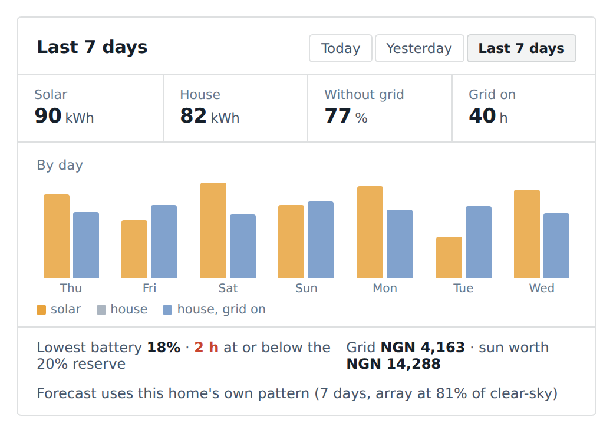
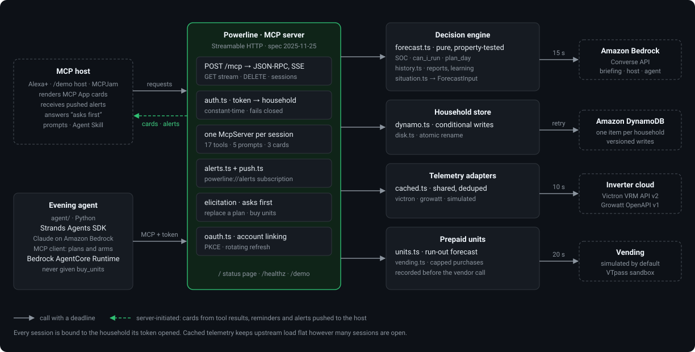

# Powerline — Alexa+ home power copilot

[](https://github.com/EdidiongA/powerline/actions/workflows/ci.yml)
[](test/)
[](https://modelcontextprotocol.io)
[](src/ui/)
[](docs/DEPLOY.md)
[](LICENSE)

**Build, Ship, Shape: Amazon Developer Hackathon 2026 · Alexa+ track · AWS Builder + Open Source mini-challenges**

Millions of households on unreliable grids make power decisions by guesswork: *Can I run the iron? Will the
battery last the night? When is grid coming back?* Powerline makes the inverter conversational. It is a
self-hosted **MCP server (spec 2025-11-25, Streamable HTTP)** that forecasts the battery from live inverter
data, answers with **interactive MCP App cards**, plans the day around the sun, **reminds you itself** when
it is time, **learns the household's own pattern**, and ships with its **own simulated Alexa+ host** so
anyone can try it in a browser.



### At a glance

| | |
| --- | --- |
| **Tools · prompts · cards · resources** | 14 · 5 · 3 · 4 — every tool annotated (`readOnly` / `destructive` / `idempotent`) |
| **Decides** | `can_i_run`, `plan_day` from a property-tested forecast: SOC integration, learned grid pattern, clear-sky solar scaled by the array's *observed* yield |
| **Acts** | `arm_plan` → reminders pushed over the session stream at each start time; low-battery / grid alerts; asks first (elicitation) before replacing a committed plan |
| **Remembers** | profile, appliances, tariff, armed plan, 14 days of hourly history per household — DynamoDB (conditional writes) or disk |
| **Learns** | after 3 days the forecast uses *this* home's hour-by-hour load shape and real solar yield; the report says so |
| **Reports** | solar made, house used, grid hours and cost, worst battery point — today / yesterday / week |
| **Real data** | Victron VRM (live against a real installation), Growatt OpenAPI (replay-tested), simulator |
| **Host** | `/demo`: full MCP Apps host (SDK `AppBridge`), pushed alerts as toasts, elicitation dialog, voice in/out, Bedrock or offline rule router |
| **Identity** | bearer token = household; sessions bound to it; fails closed; CORS for browser hosts; **OAuth 2.1 account linking built in** (discovery, dynamic registration, consent page, PKCE, rotating refresh) — the flow Alexa+ uses, proven with the official client |
| **Weather** | optional Open-Meteo radiation forecast for the household's coordinates replaces the clear-sky curve; falls back silently |
| **AWS** | Amazon Bedrock briefing (deadline + fallback), Amazon DynamoDB store, `apprunner.yaml` deploy from GitHub |
| **Proven** | 111 tests — unit, property (1,500 random households), fuzz (350 hostile calls), real-process transport, end-to-end with the official client — plus headless-Chromium host checks; CI on Ubuntu + Windows + Docker |
| **For agents** | Agent Skill (`skills/`), prompts, household resource, 24-entry friction log, docs PR upstream |

Supported inverter platforms: **Growatt** (ShinePhone API token) and **Victron Energy** (VRM Portal access
token). A built-in simulator runs without any hardware.

### Track requirement at a glance

| Requirement | Where it is called at runtime |
| --- | --- |
| **Alexa+ track** — self-hosted MCP server, spec **2025-11-25**, **Streamable HTTP** | [`src/http.ts`](src/http.ts) — `WebStandardStreamableHTTPServerTransport` from `@modelcontextprotocol/server` v2; POST / GET (SSE) / DELETE on `/mcp`, sessions keyed by `Mcp-Session-Id` |
| MCP Apps (cards), prompts, server-initiated notifications | [`src/tools/status.ts`](src/tools/status.ts) and [`planning.ts`](src/tools/planning.ts) — `registerAppTool` / `registerAppResource` (`@modelcontextprotocol/ext-apps`); [`src/tools/prompts.ts`](src/tools/prompts.ts); [`src/alerts.ts`](src/alerts.ts) — `sendLoggingMessage` on the GET stream |
| Agent Skill | [`skills/powerline-home-power/SKILL.md`](skills/powerline-home-power/SKILL.md) |
| **AWS Builder** — Amazon Bedrock, Amazon DynamoDB | [`src/bedrock.ts`](src/bedrock.ts) — `ConverseCommand`; [`src/store/dynamo.ts`](src/store/dynamo.ts) — conditional `PutItem` on `version` |
| **Open Source** — MIT, created in the window | [`LICENSE`](LICENSE), [`CHANGELOG.md`](CHANGELOG.md); upstream docs PR to the MCP TypeScript SDK |

## Evaluate it in five minutes

No inverter, no AWS account, nothing to install beyond Docker (or Node).

```bash
git clone https://github.com/EdidiongA/powerline && cd powerline
docker compose up                      # simulator at night, battery at 34 %; endpoint on :3000
```

Then open **http://127.0.0.1:3000/demo** — Powerline's own **simulated Alexa+ host**: a complete MCP Apps
host in one page (a real MCP client to `/mcp`, cards rendered through the SDK's `AppBridge`, alerts and
reminders arriving as they are pushed, voice in and out). It runs on Amazon Bedrock when `BEDROCK_MODEL_ID`
is set and on a deterministic phrase router otherwise, and says which in its header. It is a stand-in for
the device, and says that too.



Or connect any other MCP Apps host to `http://127.0.0.1:3000/mcp` — [MCPJam Inspector](https://www.mcpjam.com)
(`npx @mcpjam/inspector@latest`, **Add server → HTTP**) — and say:

1. **Set up my solar: 4.5 kW array, 10 kWh battery, 5 kW inverter, 20% reserve**
2. **Remember the iron uses 2000 watts for 30 minutes**
3. **How's the power?** → dashboard card: state of charge, a plain verdict, the 24-hour ribbon
4. **Can I run the iron for 30 minutes?** → *Not now — best time 09:00*, from the forecast, not a guess
5. **Plan my power for today** → planner card; untick an appliance and watch it re-plan
6. **How did we do this week?** → report card. To have a week of readings to show, seed history **ending at the simulator's clock** before the server starts: `SEED_END=2026-10-01T20:00:00Z npm run seed:history` (with Docker: `docker compose exec -e SEED_END=2026-10-01T20:00:00Z powerline node dist/seed-history.js`, then re-ask)
7. Click **Arm plan** on the card → Powerline confirms each start time, then pushes *"It's 09:00 — run the iron now"* over the session stream when that time arrives, unprompted. The simulator runs a minute per second, so start with `SIM_SPEED=600` to watch it land in about a minute
8. **Use the evening_briefing tool** → one spoken paragraph (Bedrock when `BEDROCK_MODEL_ID` is set)

Without Docker: `npm install && npm run build && npm start`. Tests: `npm test` (111; only the end-to-end suite touches the network, and only on localhost).
Live inverter data: `POWER_SOURCE=victron VRM_DEMO=1 npm start` reads Victron's public demo installation.

## Quick start

```bash
npm install
npm run build          # bundles the MCP App card + compiles the server
npm start              # simulator; MCP endpoint at http://127.0.0.1:3000/mcp
npm run start:aws      # same, but loads .env (AWS credentials + BEDROCK_MODEL_ID) for the Bedrock briefing
npm run smoke          # (second terminal) full protocol round-trip through every tool + alert stream
# to see an alert during smoke: SIM_START_SOC=29 SIM_CLOCK_START=2026-09-09T20:30:00Z ALERT_INTERVAL_MS=2000 npm start
npm test               # forecast, situation, cards, tools, HTTP transport, store, auth, Growatt replay — 111 tests; e2e drives the real process with the official client
```

Live telemetry:

```bash
# Victron — your own site (VRM Portal → Preferences → Integrations → Access tokens)
POWER_SOURCE=victron VRM_TOKEN=... VRM_SITE_ID=123456 npm start
# Victron — public demo site, no account needed
POWER_SOURCE=victron VRM_DEMO=1 VRM_SITE_ID=219742 npm start
# Growatt (ShinePhone → Me → username → API Token; app-generated tokens are most reliable)
POWER_SOURCE=growatt GROWATT_TOKEN=... npm start
```

Connect any Streamable-HTTP + MCP-Apps client (MCPJam, Claude Desktop, VS Code, Postman, Goose) to `/mcp`. For a public URL use `ngrok http 3000` and set `HOST=0.0.0.0`.

## What it looks like

| "How's the power?" | "Plan my power for today" |
| --- | --- |
|  |  |

| "How did we do this week?" |
| --- |
|  |

All three are **MCP App** views rendered inside the host's conversation. The planner calls back into the
server (`callServerTool`) when an appliance is ticked, **Arm plan** makes Powerline push a reminder at each
start time without being asked, and the report's tabs re-query the server for today / yesterday / the week.

## Tools

| Tool | Say | Returns |
| --- | --- | --- |
| `power_status` | "How's the power?" | Solar / load / battery / grid + 24 h battery forecast. **Dashboard card.** |
| `can_i_run` | "Can I run the iron for 30 minutes?" | Yes / not now, projected SOC, best start time today. |
| `evening_briefing` | "Power briefing" | One spoken paragraph (Amazon Bedrock when configured). |
| `setup_system` | "Set up my solar" | Stores array kW, battery kWh, inverter kW, reserve % and the household's UTC offset. Persists across sessions. |
| `add_appliance` / `list_appliances` | "Remember the washing machine is 500 watts", "add the kettle" | Appliances by name for planning. Common appliances need no wattage: twenty presets (iron, kettle, pump, AC, fridge…) with aliases ("pumping machine", "split unit"). |
| `plan_day` | "Plan my power for today" | Schedules all known appliances into the next 24 h, solar-surplus first. **Interactive planner card** — tick/untick appliances and the plan re-runs live. |
| `remove_appliance` | "Forget the pump" | Drops an appliance and any reminder armed for it. |
| `arm_plan` / `disarm_plan` | "Arm the plan" / "Cancel the reminders" | Commits the plan. Powerline then **acts on its own**: at each start time it pushes *"It's 10:00 — run the iron now, the sun is covering it"* over the session stream. The planner card has an **Arm plan** button that does the same. Replacing a plan that is already armed **asks first** via MCP elicitation when the host supports it. |
| `log_grid_event` | "Grid just went off" | Feeds the learned per-weekday grid-availability pattern. |
| `energy_report` | "How did we do this week?" | Solar made, house used, grid hours and cost, worst battery point — from the household's own hourly readings. **Report card** with today / yesterday / week tabs. Says what the forecast has learned. |
| `outage_outlook` | "How long can we last if NEPA goes?" | Hours of autonomy to the reserve if the grid went off now, and the hours the grid is usually off, from history. |
| `set_tariff` | "Grid costs 225 naira a unit" | Lets reports price grid energy and value the sun. |

**It learns.** The alert monitor records one reading an hour. After three full days the forecast swaps the
generic load curve for **this household's own hour-by-hour median**, and scales the clear-sky solar model by
the **array's observed yield** (dust, shade, cloud). Reports say so: *"Forecast uses this home's own pattern
(7 days, array at 81% of clear-sky)"*. `npm run seed:history` fills a week of plausible history so this can
be shown without waiting a week.

**Prompts** (`prompts/list`): `evening_outlook`, `plan_my_day`, `can_i_run`, `how_did_we_do`, `set_up_household` — the
phrasings a household actually uses, each pinning the tool sequence that answers well. **Resource**
`powerline://household` is a read-only JSON snapshot (profile, appliances, tariff, armed plan, history depth).
Every tool carries MCP annotations (`readOnlyHint`, `destructiveHint`, `idempotentHint`) so a host can decide
what needs confirmation.

**Agent Skill.** [`skills/powerline-home-power/SKILL.md`](skills/powerline-home-power/SKILL.md)
([agentskills.io](https://agentskills.io) format) teaches any agent how to drive these tools: status
before advice, convert `bestStartHour` to a clock time, offer to arm after planning, relay reminders
the moment they arrive, never invent a figure. Drop the folder into a skills directory and the MCP
server and the skill describe the same product from both sides.

**Server-initiated alerts.** Each session runs a monitor (`src/alerts.ts`) that pushes MCP `notifications/message`
over the Streamable HTTP GET stream when the battery drops within 10 points of the reserve, reaches it, or the grid
flips — no client request needed. Grid flips are also logged into the learned pattern automatically. Alerts are
structured (`data: { kind, text, … }`), so when a host moves to the 2026-07-28 era — where MCP logging is deprecated
in favour of `subscriptions/listen` — only the delivery call changes, not the alerts.

## How it works



```
Alexa+ / MCP client ──Streamable HTTP (sessions, SSE, CORS)──▶ src/http.ts      sessions, auth, reaper, / and /healthz
                                                                 ├─ src/auth.ts       bearer token → household (constant-time, fails closed)
                                                                 └─ src/server.ts     composition root: one McpServer per session
                                                                    ├─ src/tools/      household · status · planning · briefing
                                                                    ├─ src/situation.ts  live telemetry + stored household → ForecastInput
                                                                    ├─ src/forecast.ts   SOC integration, can_i_run, plan_day, grid learning (pure)
                                                                    ├─ src/history.ts    daily reports, learned load shape + PV yield, autonomy (pure)
                                                                    ├─ src/alerts.ts     server→client alerts + armed-plan reminders on the GET stream
                                                                    ├─ src/store/        disk (atomic) | dynamodb (conditional writes)
                                                                    ├─ src/telemetry/    sim | victron (VRM v2) | growatt (OpenAPI v1), shared cache
                                                                    ├─ src/bedrock.ts    Converse API briefing (AWS Builder), timeout + fallback
                                                                    └─ src/ui/           MCP App cards: dashboard + planner (Vite → single HTML)
```

**Forecast engine** (`src/forecast.ts`, pure functions, property-tested over thousands of random households): `net = pv + grid − load`, SOC integrated at
15-minute steps over the battery capacity and clamped; the grid covers deficits only when available.
`can_i_run` re-runs the forecast with the appliance added and, if the reserve would be breached, scans the
next 24 h for the earliest slot that either keeps SOC above the reserve or runs entirely on PV surplus.
Grid availability is learned from logged on/off events, binned per weekday-hour.

**Cards.** Two MCP App views (`src/ui/`), designed as an instrument readout rather than a
dashboard of tiles: the state of charge and a plain-language verdict ("holds past midnight") lead,
a quiet three-column strip carries the live figures, and a single 24-hour ribbon shows the battery
line against a solar field, grid bands and the reserve floor. The planner places each appliance as a
block on the same time track. Both views are tested in jsdom against absent, partial and hostile
payloads (`test/cards.test.ts`) — a card that throws renders as a blank box in the host, so this is
the failure mode worth guarding.

**Acting, not only advising.** `arm_plan` turns the schedule into commitments stored with the
household. Each session's monitor watches the clock and delivers the reminder at the right moment;
items due immediately are announced at arm time. The grace window stretches to cover any gap since
the previous tick, so a laptop that sleeps through a start time still delivers the reminder when it
wakes. Reminders are marked fired in the shared record under the same conditional write as
everything else, so several open sessions never double-remind.

**Account linking (OAuth 2.1).** With `API_TOKENS` set, Powerline is also an OAuth 2.1 authorization server
(`src/oauth.ts`): `/.well-known/oauth-protected-resource` and `/.well-known/oauth-authorization-server`
discovery, `POST /oauth/register` (public clients, loopback or https redirects only), a consent page at
`/oauth/authorize` where the person types the household and its secret, and `POST /oauth/token` for the
authorization-code (PKCE S256, single-use codes) and refresh-token (rotating) grants. A `401` from `/mcp`
carries `resource_metadata`, so a spec-following host — Alexa+, or the official MCP client — discovers,
registers, links and talks without any manual token. `test/oauth.test.ts` drives that whole flow with the
official client against a real process, plus the refusals (wrong secret, bad verifier, reused code, foreign
redirect). Tokens live in process memory; a restart means re-linking.

**Auth and identity.** `API_TOKENS=lagos-home:…,office:…` makes the bearer token the household:
a session opened with one household's token can never read, write or attach to another's, even by
guessing a session id (it gets `404`). Comparison is constant-time across all credentials; failures
return `401` with a `WWW-Authenticate` challenge; a set-but-malformed variable fails closed rather
than open. Left unset for local development, the endpoint is open and everything is one demo
household — the startup line says which. Alexa account linking is the OAuth flow
above; nothing downstream changes.

**Store.** Powerline has two writers by design — tool calls, and the per-session alert monitor
that logs grid flips on a timer — so a read-modify-write store loses updates. The DynamoDB
backend carries a `version` attribute and writes conditionally; on conflict the mutation is
**re-applied to freshly read data** rather than the stale copy, and the update cycle uses a
strongly consistent read so the version it checks is current. Throttling and 5xx are retried
with exponential backoff and full jitter; a missing table or bad credentials fail immediately
with the command that fixes them. Records are bounded before every write, so an item can never
exceed DynamoDB's 400 KB limit. There is deliberately **no silent fallback to disk**: a store
that quietly writes to two places is worse than one that says it is unavailable, so `/healthz`
reports 503 with the reason and the server keeps serving.

```bash
npm run dynamo:init                        # create the table (on-demand billing, idempotent)
STORE=dynamodb npm run start:aws           # run against it
curl localhost:3000/healthz                # backend, table, region, session count
```

**Telemetry adapters** implement one interface (`src/telemetry/types.ts`) returning
`{pv_w, load_w, battery_w, soc_pct, grid_w, grid_available}`. Adding a brand is one file.

- **Victron VRM** — one `stats?type=custom` call (`Pdc`, `ac_loads`, `bp`, `bs`, `gp`). Tested live against the VRM
  demo installation (`VRM_DEMO=1`).
- **Growatt OpenAPI v1** — `plant/list → device/list → mix_last_data | tlx_last_data`. Tested against
  recorded payload shapes for both device families (`test/fixtures/growatt/`): day, night on grid, night
  outage, string-typed numbers from MIN/TLX units, sparse payloads and API errors. Not yet run against a
  live unit; the raw payload is retained so a mismatch can be diagnosed from the friction log.

**Prior art:** a read-only [Victron VRM MCP server](https://github.com/gimi-q/victron-vrm-mcp) wraps the VRM API 1:1.
Powerline is not an API wrapper — the value is the forecast, the decision tools, cross-session household
memory, multi-vendor telemetry, and the interactive card.

## Environment

| Var | Default | Notes |
| --- | --- | --- |
| `PORT` / `HOST` | `3000` / `127.0.0.1` | `HOST=0.0.0.0` behind a tunnel |
| `ALLOWED_ORIGINS` | localhost only | comma-separated browser origins |
| `API_TOKENS` | unset = open | `household:secret,household:secret` — the token identifies the household; each session is scoped to it. `API_TOKEN=<secret>` alone still works and maps to `DEMO_USER_ID`. Set but malformed → every request rejected (fails closed). |
| `STORE` | `disk` | `disk` \| `dynamodb` |
| `DATA_DIR` | `./data` | disk store location |
| `DYNAMO_TABLE` / `DYNAMO_ENDPOINT` / `DYNAMO_MAX_ATTEMPTS` | `powerline` / – / `6` | DynamoDB store |
| `MAX_SESSIONS` | `500` | initialize is refused with 503 beyond this |
| `SESSION_TTL_MS` | `21600000` (6 h) | idle sessions are closed after this; long by default so an armed reminder still reaches a quiet household |
| `TELEMETRY_TTL_MS` | `10000` | shared cache in front of the inverter API |
| `DEMO_USER_ID` | `demo-household` | stand-in for authenticated identity |
| `TZ_OFFSET` | `1` | server-default UTC offset in hours; a household's own `setup_system … tzOffset` overrides it |
| `WEATHER_LAT` / `WEATHER_LON` | unset | Open-Meteo radiation forecast for these coordinates drives the solar curve (real clocks only) |
| `OAUTH_ACCESS_TTL_S` / `OAUTH_REFRESH_TTL_S` | `3600` / 30 days | OAuth token lifetimes |
| `PUBLIC_URL` | derived from `x-forwarded-proto`/`x-forwarded-host`, else the request | the origin advertised in OAuth metadata and `resource_metadata` challenges; set it behind a proxy that strips forwarding headers |
| `DEMO_LLM_PER_MINUTE` | `60` | ceiling on model calls from the simulated host |
| `POWER_SOURCE` | `sim` | `sim` \| `victron` \| `growatt` |
| `SIM_ARRAY_KW` / `SIM_BATTERY_KWH` / `SIM_SPEED` | `4.5` / `10` / `60` | simulator; speed = sim-seconds per real second |
| `SIM_START_SOC` / `SIM_CLOCK_START` | `65` / now | simulator starting SOC and ISO clock start (for demos at "night") |
| `ALERT_INTERVAL_MS` / `ALERT_REPEAT_MS` | `30000` / `900000` | alert poll interval; repeat while condition persists |
| `VRM_TOKEN` / `VRM_DEMO` / `VRM_SITE_ID` | — | Victron |
| `GROWATT_TOKEN` / `GROWATT_BASE_URL` / `GROWATT_PLANT_ID` / `GROWATT_DEVICE_SN` / `GROWATT_DEVICE_TYPE` | — | Growatt (type 5 = SPH, 7 = MIN) |
| `AWS_REGION` / `BEDROCK_MODEL_ID` | unset = disabled | e.g. `us.anthropic.claude-haiku-4-5-20251001-v1:0`; `BEDROCK_TIMEOUT_MS` (15000) caps the call, plain facts on failure |

## What is real and what is simulated

Judges and users deserve the line drawn clearly.

| Real | Simulated / not claimed |
| --- | --- |
| The MCP server, transport, sessions, auth, cards, prompts, skill, alerts and reminders — all run as shown, through any MCP Apps host. | **The host.** `/demo` is Powerline's own simulated Alexa+ host (a genuine MCP Apps host, but not Alexa), and MCPJam Inspector is the other host used in the demo; no claim is made of a completed connection inside the production Alexa+ app. The simulated host's language model is Amazon Bedrock when configured, otherwise a phrase router — the header says which. |
| **Victron VRM** telemetry — read live from Victron's public demo installation (a real site) and from any site with a personal access token. | **Growatt** — replay-tested against recorded payloads from both device families; not yet run against a live unit. |
| **Amazon Bedrock** phrases the briefing; **Amazon DynamoDB** stores households — both exercised at runtime with the project's own account. | **The default telemetry** is a simulator (clear-sky Lagos curve, scripted outage bands) so the project runs with no hardware and no account. |
| The forecast engine — pure arithmetic on the household's own numbers, property-tested. **Weather** — Open-Meteo's radiation forecast for the household's coordinates, when `WEATHER_LAT/LON` are set. | Without coordinates (and on a simulated clock) the solar curve is the clear-sky model; a provider forecast (VRM exposes one) is used only when it is a full, finite series. The card footer always says which source is in play. |

## Deploying where Alexa+ can reach it

Local use needs nothing beyond `npm start`. For a public, token-protected HTTPS endpoint — a tunnel
for a demo, AWS App Runner for always-on, or a Raspberry Pi beside the inverter — see
[`docs/DEPLOY.md`](docs/DEPLOY.md). What changed when is in [`CHANGELOG.md`](CHANGELOG.md); what got in
the way is in [`FRICTION_LOG.md`](FRICTION_LOG.md).

## Roadmap (hackathon window)

- [x] Streamable HTTP sessions, MCP App dashboard, forecast engine, Victron + Growatt + sim adapters
- [x] `plan_day` interactive planner card (toggle appliances → re-plans via `callServerTool`)
- [x] Server-initiated low-battery / grid alerts over the GET SSE stream
- [x] `arm_plan`: reminders pushed at each start time without being asked
- [x] Bedrock briefing with plain-facts fallback; DynamoDB store with conditional writes
- [x] Per-household bearer tokens (fail-closed), session ↔ household binding, CORS for browser hosts
- [x] Docker image + compose; CI on Ubuntu + Windows; 111 tests including property tests, a fuzz suite, an end-to-end suite over real Streamable HTTP with the official MCP client, on the engine and a boot-the-real-process transport suite
- [x] MCP prompts, an Agent Skill, tool annotations, a household resource, and elicitation before the one destructive action
- [x] History: hourly samples, energy reports with cost, outage outlook, and a forecast that learns the household's own load shape and real solar yield
- [x] `apprunner.yaml` — deploy from GitHub to AWS App Runner with no container build
- [x] Per-household timezone (`setup_system … tzOffset`)
- [x] OAuth 2.1 account linking (PKCE, dynamic registration, consent page) — the Alexa+ linking path, tested with the official client
- [x] Weather-aware solar forecast (Open-Meteo), with clear-sky fallback
- [x] Simulated Alexa+ host at `/demo`: full MCP Apps host (AppBridge), Bedrock or rule router, voice, elicitation, pushed alerts
- [x] Appliance presets so "add the kettle" just works
- [ ] Demo video < 3 min, product feedback, friction log

## License

MIT
